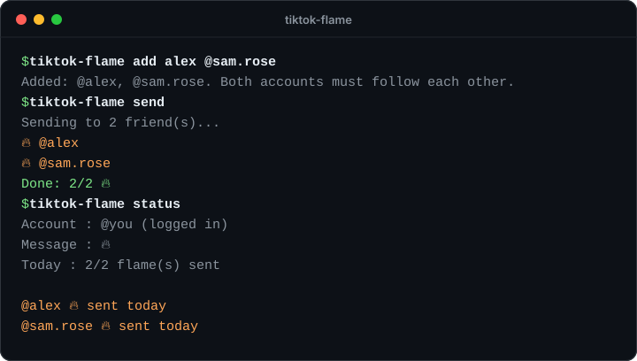

<div align="center">

# 🔥 tiktok-flame

**Ne perds plus jamais une flamme TikTok.**

Un petit outil en ligne de commande qui envoie ta 🔥 du jour aux amis que tu choisis,<br>
pour que tes séries continuent même les jours où tu oublies.

[](https://github.com/mathyouadr/tiktok-flame/actions/workflows/tests.yml)


[](LICENSE)

[English](README.md) · Français



</div>

---

## ✨ Ce qu'il fait

- **Jamais de mot de passe.** Tu te connectes avec le QR code officiel de TikTok, affiché directement dans le terminal. Ou tu ouvres une fenêtre de navigateur avec `--window` et tu te connectes comme tu veux.
- **Tes amis, ton message.** Ajoute quelqu'un par pseudo, `@pseudo` ou lien de profil. Un message par défaut (🔥), ou un message différent pour chaque ami.
- **Jamais deux fois le même jour.** Chaque ami reçoit un seul message par jour, même si tu lances l'outil plusieurs fois.
- **Il vérifie.** Il ouvre la conversation depuis le profil de ton ami, contrôle que l'en-tête affiche la bonne personne, et ne compte la flamme comme envoyée que quand le message apparaît dans la conversation.
- **Mode test sans risque.** `send --dry-run` fait tout sauf appuyer sur Entrée : il tape le message, puis l'efface.
- **Fait pour cron.** `--jitter` ajoute un délai aléatoire, `--quiet` n'affiche que les problèmes, les codes de sortie sont pensés pour les scripts, et un webhook Discord ou Slack peut te prévenir en cas de souci.
- **Marche partout où Python marche.** Linux, macOS, Windows, un Raspberry Pi, un serveur sans écran.

## ⚙️ Comment ça marche

tiktok-flame pilote un vrai navigateur Chromium en arrière-plan avec [Playwright](https://playwright.dev/python/), comme tu le ferais sur tiktok.com :

```
profil de ton ami → « Message » → tape 🔥 → Entrée → vérifie que la bulle 🔥 est apparue
```

Ta session TikTok reste dans un profil de navigateur sur **ton** ordinateur. Rien n'est envoyé ailleurs : pas de serveur, pas de télémétrie. La seule autre chose qu'il contacte, c'est le webhook que tu configures toi-même, si tu en configures un.

> [!NOTE]
> Une flamme demande des messages **des deux côtés** chaque jour. tiktok-flame s'occupe des tiens. Ton ami doit quand même répondre, ou utiliser tiktok-flame lui aussi 😉

## 📦 Installation

Il faut **Python 3.10+** et environ 300 Mo d'espace disque pour le navigateur.

```bash
pipx install git+https://github.com/mathyouadr/tiktok-flame
tiktok-flame setup          # télécharge Chromium pour Playwright
```

<details>
<summary>Sans pipx</summary>

```bash
python -m venv ~/.tiktok-flame-venv
~/.tiktok-flame-venv/bin/pip install git+https://github.com/mathyouadr/tiktok-flame
~/.tiktok-flame-venv/bin/tiktok-flame setup
```
Sous Windows, les programmes du venv sont dans `Scripts\` au lieu de `bin/`.
</details>

<details>
<summary>Linux sans écran (serveur, Raspberry Pi) : il manque des bibliothèques ?</summary>

Si Chromium ne démarre pas, installe ses dépendances une fois, en root :
```bash
sudo $(which python3) -m playwright install-deps chromium
```
</details>

## 🚀 Démarrage rapide

```bash
tiktok-flame login                  # scanne le QR code avec l'appli TikTok
tiktok-flame add alex @sam.rose     # les amis avec qui garder la flamme
tiktok-flame send --dry-run         # répétition : tape, efface, n'envoie rien
tiktok-flame send                   # pour de vrai 🔥
```

**Tu te connectes depuis ton téléphone ?** Le terminal affiche aussi le lien du QR code (`https://www.tiktok.com/t/...`). Ouvre-le sur le téléphone où l'appli TikTok est connectée, puis confirme.

> [!IMPORTANT]
> Tu ne peux écrire qu'aux personnes avec qui vous **vous suivez mutuellement**. Sinon TikTok n'affiche pas de bouton « Message ».

## ⏰ Le lancer tous les jours

Affiche des commandes prêtes à copier pour ta machine :

```bash
tiktok-flame schedule
```

**Linux / macOS** (`crontab -e`), tous les jours entre 11h45 et 12h15 :
```cron
45 11 * * * /chemin/vers/tiktok-flame send --jitter 30 --quiet
```

**Windows** (PowerShell) :
```powershell
schtasks /Create /SC DAILY /ST 11:45 /TN tiktok-flame /TR "tiktok-flame send --jitter 30 --quiet"
```

L'ordinateur doit être allumé à cette heure-là. Une machine toujours allumée (Raspberry Pi, serveur maison, petit VPS) est idéale.

**Être prévenu quand ça casse** (session expirée, message raté) :
```bash
tiktok-flame webhook https://discord.com/api/webhooks/... --test
```

## 🧰 Commandes

| Commande | Rôle |
|---|---|
| `setup` | Télécharge le navigateur Chromium |
| `login [--window] [--invert]` | Connexion par QR code dans le terminal, ou dans une fenêtre visible. `--invert` pour les terminaux à fond clair |
| `check` | Vérifie que la session enregistrée marche encore |
| `logout` | Supprime la session enregistrée |
| `add PSEUDO... [-m TEXTE]` | Ajoute des amis, avec leur propre message si tu veux |
| `remove PSEUDO...` | Retire des amis |
| `pause PSEUDO...` / `resume PSEUDO...` | Met des amis en pause sans les retirer |
| `message [TEXTE] [--user PSEUDO] [--reset]` | Affiche ou change le message par défaut, ou celui d'un ami |
| `status [--json]` | Amis, avancement du jour, dernier envoi |
| `send` | Envoie les flammes du jour à tous ceux qui n'en ont pas encore eu |
| `send --dry-run` | Répétition : tape, efface, n'envoie jamais |
| `send --only PSEUDO...` | Seulement ces amis |
| `send --jitter MIN` | Attend d'abord entre 0 et MIN minutes, au hasard |
| `send --force` | Envoie même aux amis déjà servis aujourd'hui |
| `send --window` | Montre le navigateur pendant qu'il travaille (débogage) |
| `webhook URL\|off [--test]` | Envoie les problèmes sur un webhook Discord ou Slack |
| `schedule` | Comment le lancer tous les jours |

Un message par ami :
```bash
tiktok-flame message "🔥"                       # par défaut pour tout le monde
tiktok-flame message --user alex "🔥 frérot"    # seulement pour alex
```

**Codes de sortie** : `0` OK · `1` des messages ont échoué · `2` une autre exécution tourne · `3` pas connecté, lance `login`.

## 📁 Où sont tes données

| Système | Dossier |
|---|---|
| Linux | `~/.local/share/tiktok-flame` (ou `$XDG_DATA_HOME`) |
| macOS | `~/Library/Application Support/tiktok-flame` |
| Windows | `%LOCALAPPDATA%\tiktok-flame` |

Change-le avec `--home DOSSIER` ou `$TIKTOK_FLAME_HOME`. Dedans : `config.json` (amis, messages), `state.json` (qui a eu sa flamme aujourd'hui, derniers envois), `profile/` (**ta session TikTok : à protéger comme un mot de passe**) et `debug/` (une capture et un résumé de la page pour chaque message raté, les 10 derniers).

## 🩺 En cas de problème

| Symptôme | Solution |
|---|---|
| `no 'Message' button on their profile` | Vous ne vous suivez pas mutuellement, ou la personne a coupé les messages |
| `TikTok is showing a captcha` | Ouvre TikTok dans un navigateur normal ou l'appli, utilise-le un peu, réessaie plus tard. Moins d'amis et un `--jitter` aident |
| Code `3` / `session has expired` | Relance `tiktok-flame login` |
| `message box not found` | TikTok a changé son site. Lance `send --dry-run --window -v` pour regarder, puis ouvre une issue avec le fichier `.json` de `debug/` (pas la capture : elle montre tes conversations) |
| Rien ne se passe à l'heure prévue | L'ordinateur est-il allumé ? cron utilise-t-il le chemin complet de `tiktok-flame` ? |

## ⚠️ Est-ce autorisé ?

tiktok-flame est un projet **non officiel**, sans lien avec TikTok ou ByteDance. Automatiser ton compte peut aller contre les conditions d'utilisation de TikTok, qui peut restreindre les comptes qui se comportent comme des robots. **Utilise-le à tes risques**, garde-le pour quelques amis avec qui tu parles vraiment, et jamais pour du spam.

## 🛠️ Développement

```bash
git clone https://github.com/mathyouadr/tiktok-flame && cd tiktok-flame
python -m venv .venv && . .venv/bin/activate
pip install -e . && python -m playwright install chromium
python -m unittest discover -s tests -v
```

Les tests font tourner un vrai Chromium sur un **faux tiktok.com**. Ils ne touchent jamais le vrai site et n'envoient jamais de message. Ils couvrent les cas difficiles rencontrés en vrai : la bannière cookies posée sur la zone de message, une zone qui ne se vide pas après l'envoi, la mauvaise conversation qui s'ouvre, les comptes introuvables.

Le site de TikTok change souvent. Si un sélecteur casse, les pull requests sont les bienvenues. Les sélecteurs sont en haut de [`browser.py`](src/tiktok_flame/browser.py).

## 📄 Licence

[MIT](LICENSE) © 2026 Mathyou
