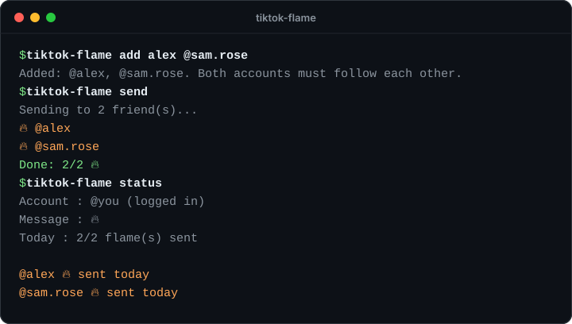

<div align="center">

# 🔥 tiktok-flame

**Never lose a TikTok streak again.**

A small command-line tool that sends your daily 🔥 to the friends you pick,<br>
so your streaks keep burning even on the days you forget.

[](https://github.com/mathyouadr/tiktok-flame/actions/workflows/tests.yml)


[](LICENSE)

English · [Français](README.fr.md)



</div>

---

## ✨ Features

- **No password, ever.** You log in with TikTok's own QR code, shown right in your terminal. Or open a normal browser window with `--window` and log in however you like.
- **Your friends, your message.** Add people by username, `@username` or profile link. Pick a default message (🔥 by default) or a custom one per friend.
- **Never twice the same day.** Each friend gets one message per day, however many times you run it.
- **It double-checks.** It opens the conversation from your friend's profile, makes sure the chat header shows the right person, and only counts a flame as sent once the message shows up in the conversation.
- **Safe test mode.** `send --dry-run` does everything except press Enter: it types the message, then erases it.
- **Built for cron.** `--jitter` adds a random delay, `--quiet` prints only problems, exit codes are script-friendly, and a Discord or Slack webhook can tell you when something goes wrong.
- **Runs everywhere Python runs.** Linux, macOS, Windows, a Raspberry Pi, a headless server.

## ⚙️ How it works

tiktok-flame drives a real Chromium browser in the background with [Playwright](https://playwright.dev/python/), just like you would on tiktok.com:

```
your friend's profile → "Message" → types 🔥 → Enter → checks the 🔥 bubble showed up
```

Your TikTok session is kept in a browser profile on **your** computer. Nothing is sent anywhere else: no server, no telemetry. The only other thing it ever contacts is the webhook you set yourself, if you set one.

> [!NOTE]
> A streak needs messages from **both** sides every day. tiktok-flame takes care of yours. Your friend still has to reply, or run tiktok-flame too 😉

## 📦 Install

You need **Python 3.10+** and about 300 MB of disk space for the browser.

```bash
pipx install git+https://github.com/mathyouadr/tiktok-flame
tiktok-flame setup          # downloads Chromium for Playwright
```

<details>
<summary>Without pipx</summary>

```bash
python -m venv ~/.tiktok-flame-venv
~/.tiktok-flame-venv/bin/pip install git+https://github.com/mathyouadr/tiktok-flame
~/.tiktok-flame-venv/bin/tiktok-flame setup
```
On Windows the venv's programs live in `Scripts\` instead of `bin/`.
</details>

<details>
<summary>Headless Linux (server, Raspberry Pi): missing system libraries?</summary>

If Chromium won't start, install its dependencies once, as root:
```bash
sudo $(which python3) -m playwright install-deps chromium
```
</details>

## 🚀 Quick start

```bash
tiktok-flame login                  # scan the QR code with the TikTok app
tiktok-flame add alex @sam.rose     # friends you want to keep a streak with
tiktok-flame send --dry-run         # rehearsal: types, erases, sends nothing
tiktok-flame send                   # the real thing 🔥
```

**Logging in from your phone?** The terminal also prints the QR code's link (`https://www.tiktok.com/t/...`). Open it on the phone where the TikTok app is logged in and confirm.

> [!IMPORTANT]
> You can only message people you **follow each other** with. Otherwise TikTok shows no "Message" button.

## ⏰ Run it every day

Print ready-to-paste commands for your machine:

```bash
tiktok-flame schedule
```

**Linux / macOS** (`crontab -e`), every day between 11:45 and 12:15:
```cron
45 11 * * * /path/to/tiktok-flame send --jitter 30 --quiet
```

**Windows** (PowerShell):
```powershell
schtasks /Create /SC DAILY /ST 11:45 /TN tiktok-flame /TR "tiktok-flame send --jitter 30 --quiet"
```

The computer has to be on at that time. An always-on box (Raspberry Pi, home server, small VPS) is ideal.

**Get told when something breaks** (expired session, failed message):
```bash
tiktok-flame webhook https://discord.com/api/webhooks/... --test
```

## 🧰 Commands

| Command | What it does |
|---|---|
| `setup` | Download the Chromium browser |
| `login [--window] [--invert]` | Log in with a terminal QR code, or in a visible window. `--invert` is for light terminal themes |
| `check` | Check that the saved session still works |
| `logout` | Delete the saved session |
| `add USER... [-m TEXT]` | Add friends, optionally with their own message |
| `remove USER...` | Remove friends |
| `pause USER...` / `resume USER...` | Skip friends for a while without removing them |
| `message [TEXT] [--user USER] [--reset]` | Show or set the default message, or one friend's message |
| `status [--json]` | Friends, today's progress, last run |
| `send` | Send today's flames to everyone not served yet |
| `send --dry-run` | Rehearsal: type, erase, never send |
| `send --only USER...` | Only these friends |
| `send --jitter MIN` | Wait a random 0 to MIN minutes first |
| `send --force` | Send even to friends already served today |
| `send --window` | Show the browser while it works (debugging) |
| `webhook URL\|off [--test]` | Post problems to a Discord or Slack webhook |
| `schedule` | How to run it every day |

Custom message per friend:
```bash
tiktok-flame message "🔥"                       # default for everyone
tiktok-flame message --user alex "🔥 bro"       # just for alex
```

**Exit codes**: `0` OK · `1` some messages failed · `2` another run is in progress · `3` not logged in, run `login`.

## 📁 Where your data lives

| OS | Folder |
|---|---|
| Linux | `~/.local/share/tiktok-flame` (or `$XDG_DATA_HOME`) |
| macOS | `~/Library/Application Support/tiktok-flame` |
| Windows | `%LOCALAPPDATA%\tiktok-flame` |

Change it with `--home DIR` or `$TIKTOK_FLAME_HOME`. Inside you'll find `config.json` (friends, messages), `state.json` (who got a flame today, last runs), `profile/` (**your TikTok session: treat it like a password**) and `debug/` (a screenshot and page summary for each failed message, last 10 kept).

## 🩺 Troubleshooting

| Symptom | Fix |
|---|---|
| `no 'Message' button on their profile` | You don't follow each other, or they turned off messages |
| `TikTok is showing a captcha` | Open TikTok in a normal browser or the app, use it a bit, try again later. Fewer friends and a `--jitter` help |
| Exit code `3` / `session has expired` | `tiktok-flame login` again |
| `message box not found` | TikTok changed its web app. Run `send --dry-run --window -v` to watch, then open an issue with the `.json` file from `debug/` (not the screenshot: it shows your chats) |
| Nothing happens at the scheduled time | Is the computer on? Does cron use the full path to `tiktok-flame`? |

## ⚠️ Is this allowed?

tiktok-flame is an **unofficial** project, not affiliated with or endorsed by TikTok or ByteDance. Automating your account may go against TikTok's Terms of Service, and TikTok may restrict accounts that act like bots. **Use it at your own risk**, stick to a handful of friends you actually talk to, and never use it for spam.

## 🛠️ Development

```bash
git clone https://github.com/mathyouadr/tiktok-flame && cd tiktok-flame
python -m venv .venv && . .venv/bin/activate
pip install -e . && python -m playwright install chromium
python -m unittest discover -s tests -v
```

The tests run a real Chromium against a **fake tiktok.com**. They never touch the real site and never send a message. They cover the tricky cases met in real life: the cookie banner over the message box, a message box that doesn't empty after sending, the wrong conversation opening, missing accounts.

TikTok's web app changes often. If a selector breaks, pull requests are very welcome. The selectors are at the top of [`browser.py`](src/tiktok_flame/browser.py).

## 📄 License

[MIT](LICENSE) © 2026 Mathyou
